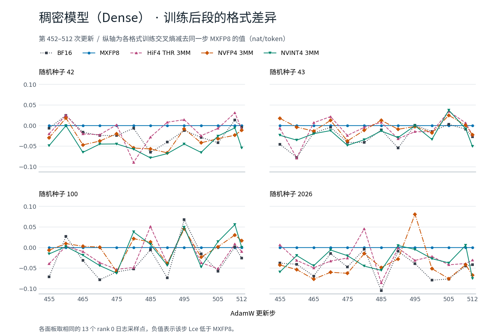
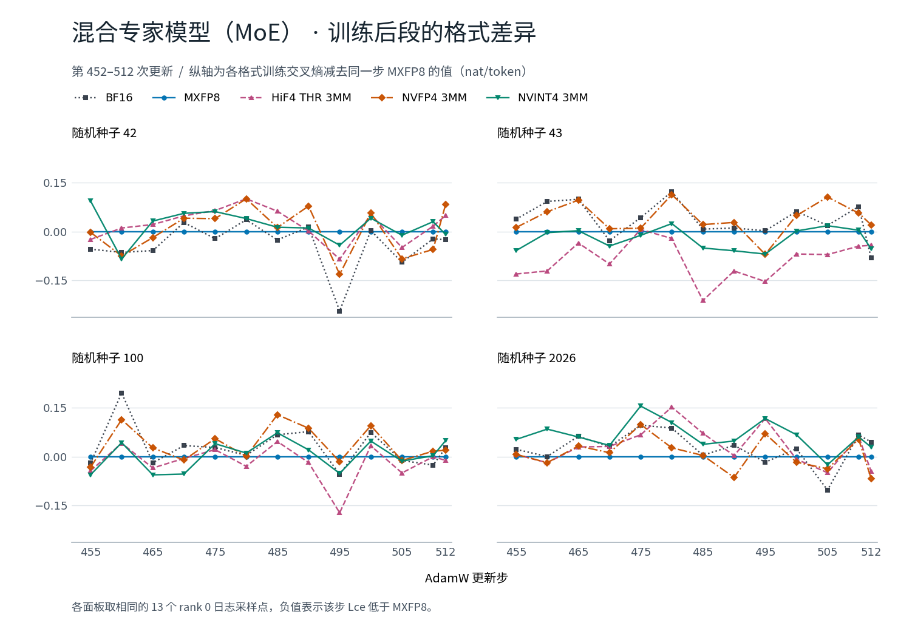
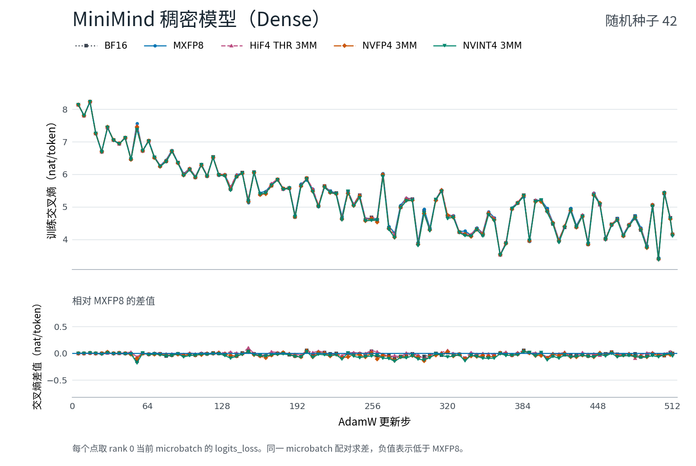
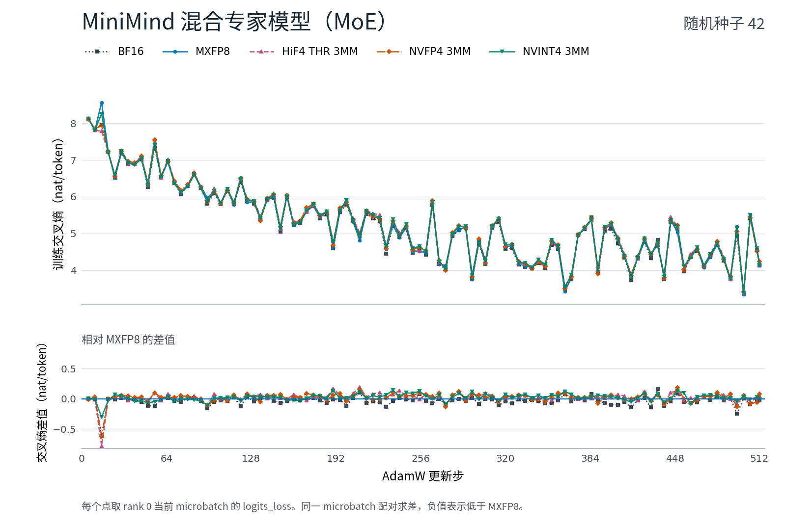
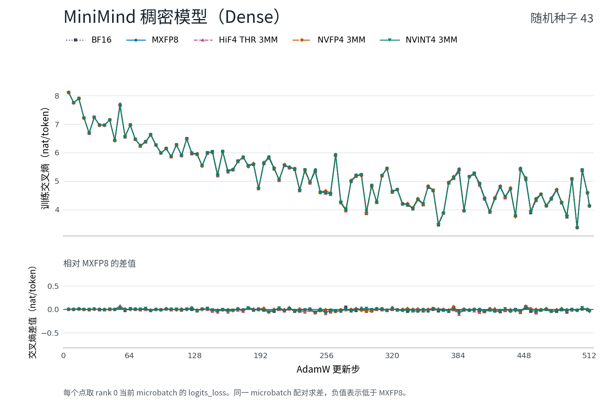
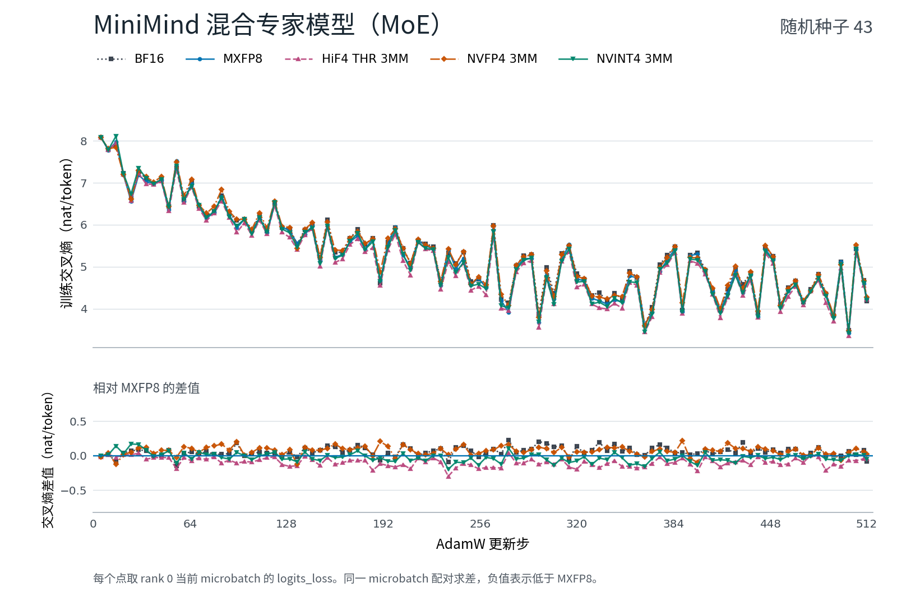
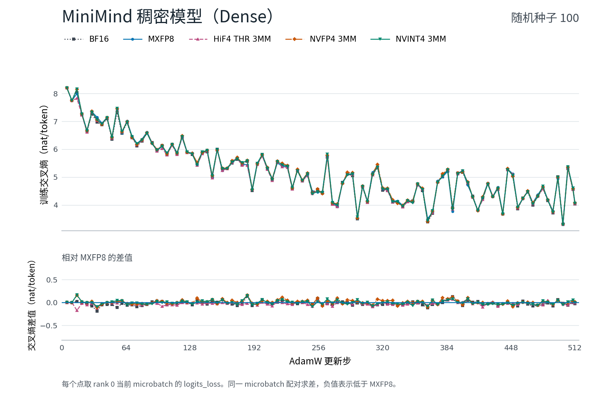
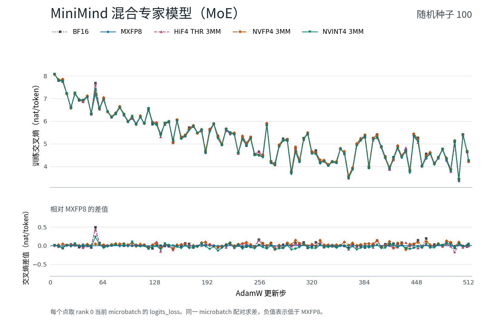
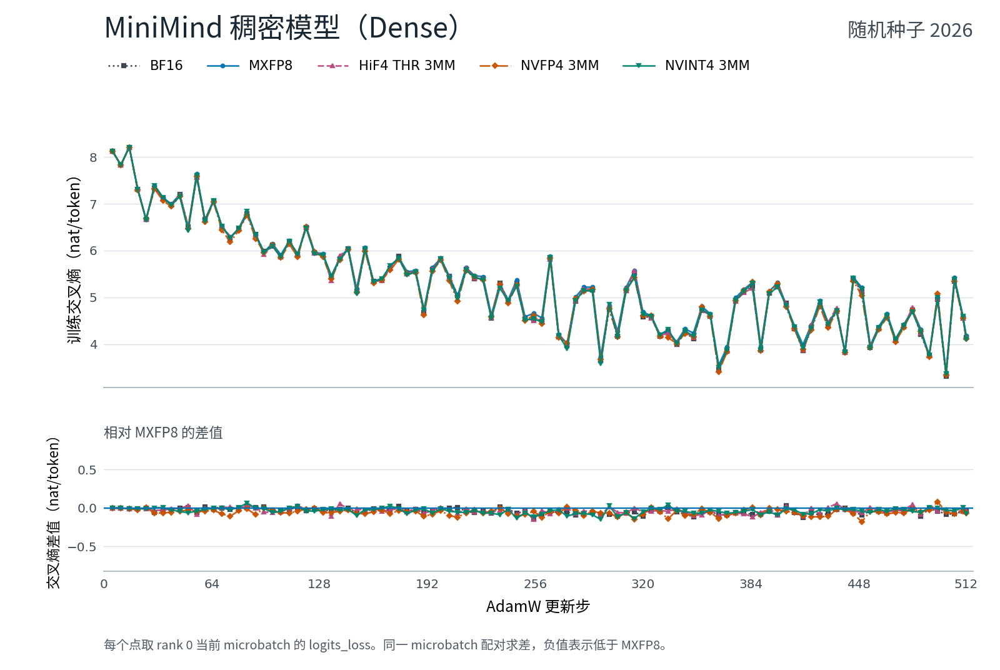
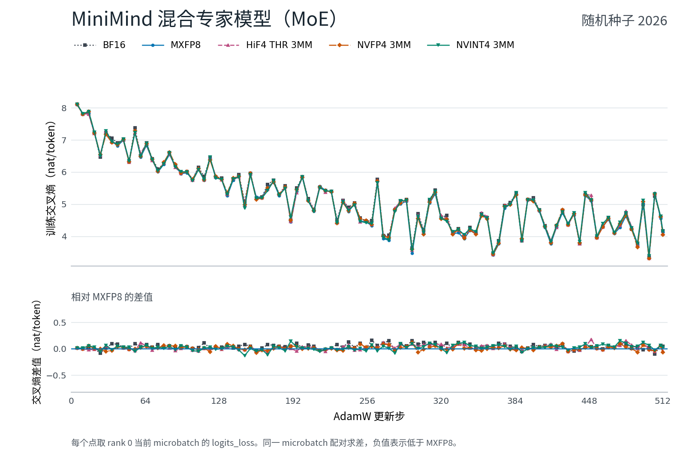

# MiniMind 四个随机种子的训练交叉熵

[下载中文交互图，保存后用浏览器打开](training_lce_interactive.html?raw=true)

交互图默认展示 seed 42 的 MoE 在第 455–512 次更新相对 MXFP8 的训练 Lce 差值。横向拖动可放大区间，图例可控制每种格式的显隐。切换到绝对 Lce 或更换参照后，纵轴根据当前可见曲线和区间调整。在曲线上选中一步，可在下方读取五种格式的四位小数值。数据已嵌入 HTML，可离线使用。

## 后段局部放大

两张图展示同一训练区间的 13 个采样点（第 455、460、…、510、512 次更新）。同一架构内的四个 seed 共用纵轴范围，便于比较差值的大小。

| 稠密模型（Dense） | 混合专家模型（MoE） |
|---|---|
|  |  |

## 全程训练曲线

每行是同一个随机种子的 Dense 和 MoE 实验。点击图片可查看大图。每张图的上半部分叠加 BF16、MXFP8、HiF4 THR 3MM、NVFP4 3MM 和 NVINT4 3MM 的训练 Lce，下半部分显示同一 microbatch 内各格式相对 MXFP8 的差。负值表示该采样点的 Lce 低于 MXFP8。八张图采用相同坐标范围。

| 随机种子 | 稠密模型（Dense） | 混合专家模型（MoE） |
|---:|---|---|
| 42 |  |  |
| 43 |  |  |
| 100 |  |  |
| 2026 |  |  |

每条曲线包含 103 个原始日志采样点。横轴是对应的 AdamW 更新步（5、10、…、510、512），纵轴为 rank 0 当前 microbatch 的 `logits_loss`，单位为 nat/token。该字段已扣除 MoE 路由辅助损失，日志保留四位小数。曲线按采样先后连线，未做平滑。

[下载 4,120 个训练采样点](training_lce.csv) · [查看终点验证集 CE 和 PPL](../same_format_validation.csv) · [绘图脚本](../../../scripts/minimind_plot_lce.py)
